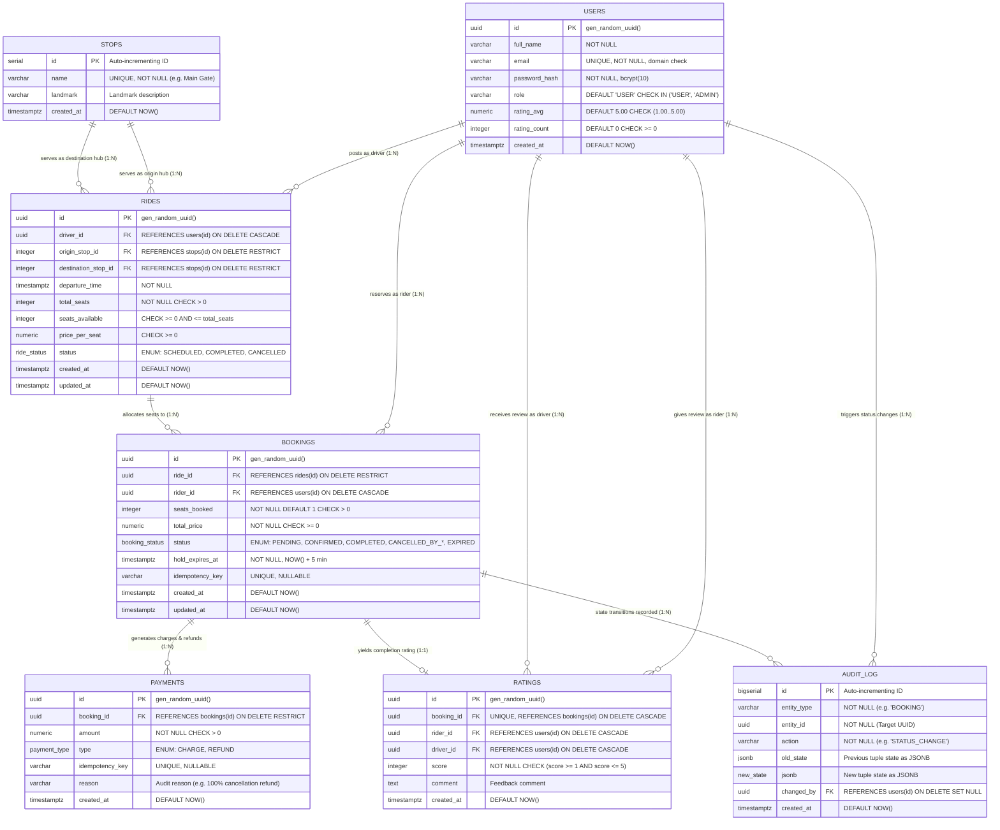

# Campus Ride-Pooling System: Entity-Relationship (ER) Diagram

This ER diagram and schema reference document the real database schema implemented in PostgreSQL for the **Campus Ride-Pooling System**.

---

## 1. Relational ER Diagram (Mermaid)



---

## 2. Table Catalog & Relational Integrity

| Table | Primary Key | Foreign Keys | Business Rule / Integrity Constraint |
|---|---|---|---|
| **`users`** | `id` (UUID) | None | `CHECK (rating_avg BETWEEN 1.00 AND 5.00)`, `UNIQUE(email)`. |
| **`stops`** | `id` (SERIAL) | None | `UNIQUE(name)`. Pick-up & drop-off hubs on & off campus. |
| **`rides`** | `id` (UUID) | `driver_id` $\to$ `users(id)`<br>`origin_stop_id` $\to$ `stops(id)`<br>`destination_stop_id` $\to$ `stops(id)` | `CONSTRAINT chk_seats_range CHECK (seats_available >= 0 AND seats_available <= total_seats)`<br>`CONSTRAINT chk_distinct_stops CHECK (origin_stop_id <> destination_stop_id)`. |
| **`bookings`** | `id` (UUID) | `ride_id` $\to$ `rides(id)`<br>`rider_id` $\to$ `users(id)` | Partial Unique Index `uq_active_rider_ride` on `(ride_id, rider_id)` WHERE `status IN ('PENDING', 'CONFIRMED')`. Trigger `trg_booking_state_machine` blocks terminal transitions. |
| **`payments`** | `id` (UUID) | `booking_id` $\to$ `bookings(id)` | Append-only ledger pattern. `CHECK (amount > 0)`. Never overwritten or updated. |
| **`ratings`** | `id` (UUID) | `booking_id` $\to$ `bookings(id)` (1:1)<br>`rider_id` $\to$ `users(id)`<br>`driver_id` $\to$ `users(id)` | `UNIQUE(booking_id)` ensures max 1 rating per trip. `CHECK (rider_id <> driver_id)`. `CHECK (score BETWEEN 1 AND 5)`. |
| **`audit_log`**| `id` (BIGSERIAL)| `changed_by` $\to$ `users(id)` | Immutable ledger capturing `old_state` and `new_state` as PostgreSQL `JSONB`. |

---

## 3. Specialized Index Architecture

```sql
-- 1. Partial Unique Index: Exactly one active seat booking per student per ride
CREATE UNIQUE INDEX uq_active_rider_ride 
ON bookings (ride_id, rider_id) 
WHERE status IN ('PENDING', 'CONFIRMED');

-- 2. Partial Composite B-Tree Index: High-speed ride searches by origin, destination & time
CREATE INDEX idx_rides_search_composite 
ON rides (origin_stop_id, destination_stop_id, departure_time) 
WHERE status = 'SCHEDULED';

-- 3. Partial B-Tree Index: Background GC worker for expired 5-minute seat holds
CREATE INDEX idx_bookings_hold_expiry 
ON bookings (hold_expires_at) 
WHERE status = 'PENDING';
```
