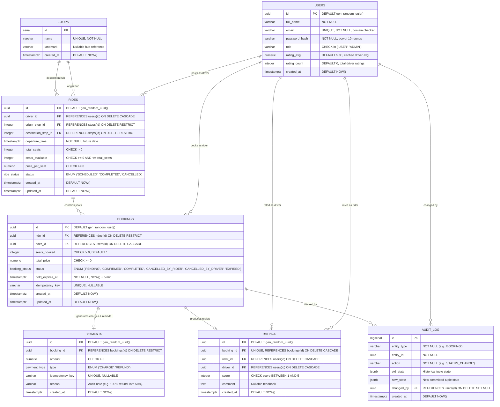

# Entity Relationship (ER) Diagram

## Database Architecture
The **Campus Ride-Pooling System** is modeled in strict compliance with Third Normal Form (3NF) relational principles, complemented by deliberate, performance-engineered denormalization for concurrency locking and search ranking.

---

## Relational Constraints & Integrity Rules
1. **Primary & Foreign Keys**:
   - `rides.origin_stop_id` and `rides.destination_stop_id` have `ON DELETE RESTRICT` preventing orphan rides.
   - `rides.driver_id` and `bookings.rider_id` reference `users(id)` with cascading deletion for clean user lifecycle management.
2. **Business Rule Check Constraints**:
   - `rides`: `CHECK (seats_available >= 0 AND seats_available <= total_seats)` prevents negative seat balances at the database engine level.
   - `rides`: `CHECK (origin_stop_id <> destination_stop_id)` prevents circular trips.
   - `ratings`: `CHECK (rider_id <> driver_id)` prevents drivers from rating themselves.
   - `ratings`: `CHECK (score BETWEEN 1 AND 5)`.
3. **Partial Unique Index**:
   - `uq_active_rider_ride ON bookings (ride_id, rider_id) WHERE status IN ('PENDING', 'CONFIRMED')`
   - Guarantees at the storage engine level that a rider can hold or confirm at most one active seat on a given ride, while allowing historical cancelled/completed bookings.
